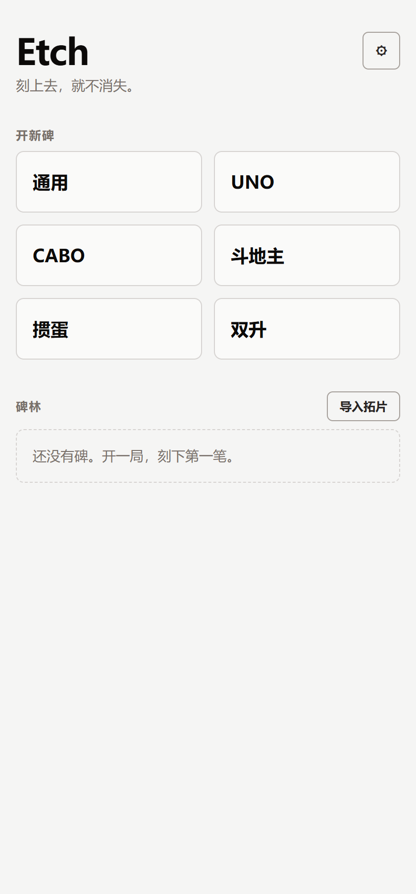
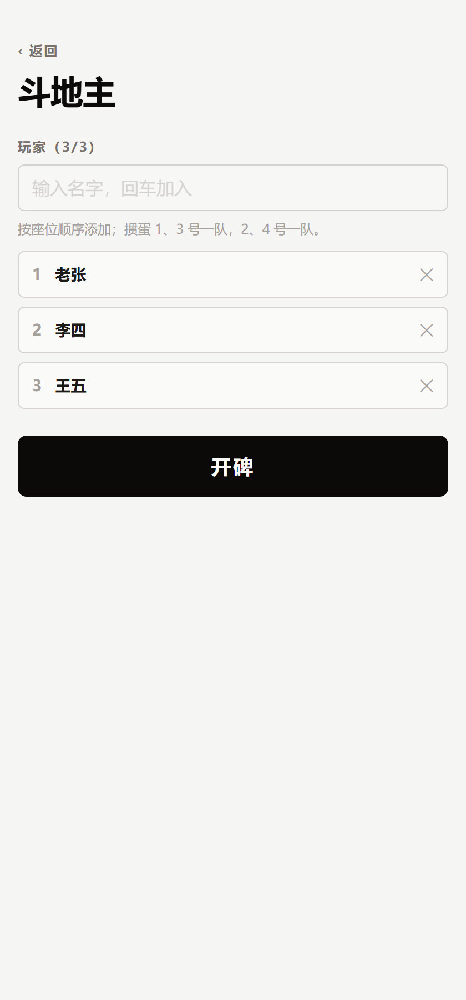
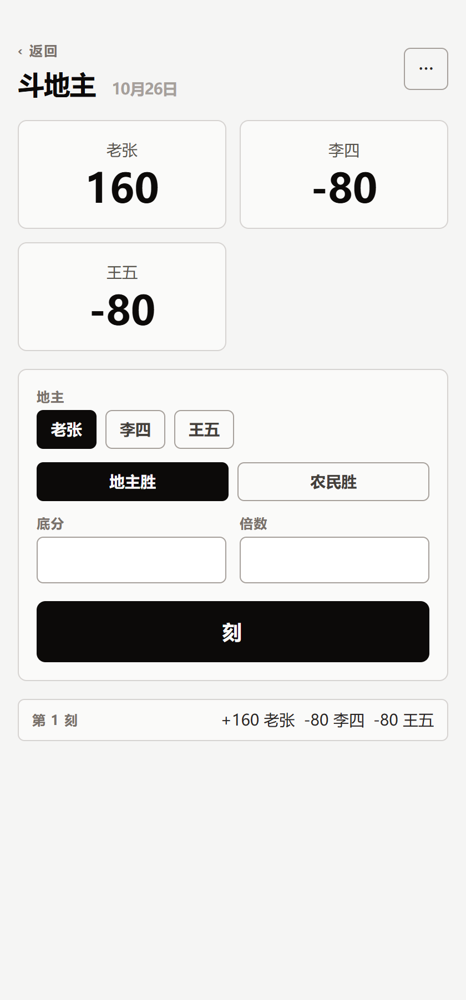
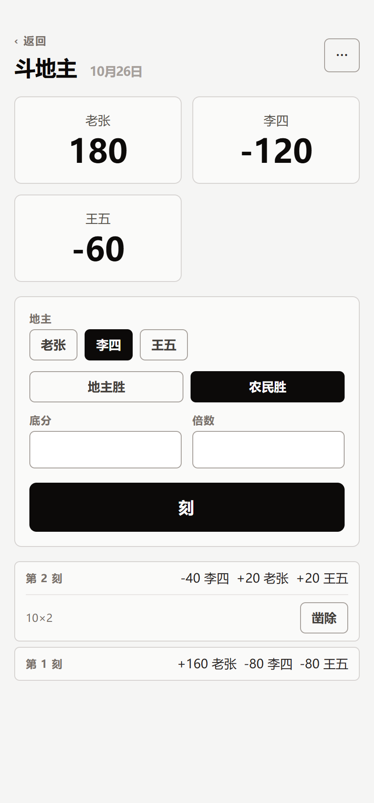

# Etch

**网页计分器 —— 刻上去，就不消失。**
_Etch — Scores that never vanish._



纸会破，内存会丢，但刻在石头上的东西不会。

Etch 是牌桌上传着用的计分器：每一笔记分是一次**刻**，落笔即永恒——不可改、不可删。改错的唯一方式是**凿除**（再刻一笔冲正，原笔划掉显示、不再计分、但永远留在碑上）。没有后端、没有账号、断网可用。

- **追加式刻痕账本**：当前分永远由全部未凿笔**折叠**得出，历史完整可查（[ADR-0001](docs/adr/0001-append-only-entry-ledger.md)）
- **单设备离线**：数据在本机 IndexedDB；PWA 可装主屏、断网可开；跨设备靠**拓片**（版本化 JSON 导出/导入）（[ADR-0002](docs/adr/0002-local-first-single-device-no-sync.md)）
- **四个模板**：通用、斗地主、UNO、掼蛋——三种不同的规则形状，各自可配**变体**
- **碑不执法**：终局条件满足只**宣告**，从不锁死刻入，补局加刻永远自由
- **中英双语**，单色高对比，落笔有"刻进去"的动效与轻微触感

领域术语（碑、笔、凿除、折叠、拓片……）见 [CONTEXT.md](CONTEXT.md)。

<br clear="right" />

## 模板

| 模板       | 规则形状 | 说明                                                                     |
| ---------- | -------- | ------------------------------------------------------------------------ |
| **通用**   | 任意整数 | 想记什么记什么，每名玩家一个增减                                         |
| **斗地主** | 倍数对称 | 底分 × 倍数，地主 ±2 份、农民各 ∓1 份，一局一次刻入                      |
| **UNO**    | 目标累积 | 计分制：赢家收对手剩牌点，先到目标分；出局制：各吃各的剩牌分，触线者出局 |
| **掼蛋**   | 队伍级数 | 4 人两队（座位 1·3 / 2·4），胜队进级、双下跳级，过 A 宣告封顶            |

UNO 的两种玩法是**同一个模板的两个变体**——计分方向（升/降）与终局条件（领跑达标 / 触线出局）都是参数，不是硬编码。

## 界面

| 开碑                                        | 碑面                                          | 凿除                                             |
| ------------------------------------------- | --------------------------------------------- | ------------------------------------------------ |
|  |  |  |

更多截图在 [docs/screenshots/](docs/screenshots)：空碑、两笔刻痕、设置。

## 快速开始

```sh
pnpm install
pnpm run dev        # http://localhost:5173
```

构建与发布：

```sh
pnpm run build      # 纯静态产物到 build/（SPA fallback）
pnpm run preview    # 本地预览构建产物
```

产物是纯静态目录 + Service Worker，**任何静态宿主都能放**（GitHub Pages、Vercel、Nginx、自己的容器）。若部署在子路径（如 GitHub Pages 项目页），构建时设置 `base`。

## 开发

```sh
pnpm run check      # svelte-check 类型检查
pnpm run lint       # prettier + eslint
pnpm run test       # 单元 + 组件 + e2e（首次会自动下载 Playwright 浏览器）
pnpm run format     # 格式化
```

测试分三层：

- `src/lib/etch/**/*.spec.ts` — 领域核心（node）：账本不变量、模板计算、拓片往返
- `src/lib/components/**/*.svelte.spec.ts` — 组件（Chromium）：渲染与交互
- `src/routes/*.e2e.ts` — e2e（构建产物 + preview 服务器）：开碑→刻→刷新持久→凿除→拓片→语言→断网

## 架构

```
src/
├── lib/
│   ├── etch/              # 领域核心：零 Svelte、零 DOM，可被 node 单测直接覆盖
│   │   ├── types.ts       # 碑 / 笔 / 变体 / 宣告
│   │   ├── ledger.ts      # append-only 不变量：折叠、追加、凿除
│   │   ├── templates/     # 四个模板：形状 + 变体参数 + 终局检测
│   │   ├── rubbing.ts     # 拓片：版本化 JSON 导出/导入（导入时重放校验）
│   │   ├── db.ts          # IndexedDB（idb）
│   │   └── store.svelte.ts# 应用状态与动作（先写盘、再让 UI 可见）
│   ├── i18n/              # 轻量双语字典
│   └── components/        # 组件
├── routes/                # 首页 / 开碑 / 碑面
└── service-worker.js      # Kit 3 SW：导航 network-first，构建产物 cache-first
```

## 技术栈

SvelteKit 3（SPA 模式）· Svelte 5 runes · Tailwind CSS 4 · TypeScript · IndexedDB（idb）· Vitest 4（browser mode）· Playwright。

## English

**Etch** is an offline-first scorekeeper for card tables with a single rule that shapes everything: _a mark, once made, is forever_. Scores are append-only; a mistake is corrected by **chiselling it off** — a reversing entry that strikes the original through, excludes it from the total, and leaves both on the tablet.

No backend, no accounts. Data lives in local IndexedDB; the app installs as a PWA and works offline. Moving between devices happens through a **rubbing** — a versioned JSON export/import.

Four templates (generic, Dou Dizhu, UNO with race/elimination variants, Guandan levels) cover three distinct scoring shapes. The stone never referees: when a win condition is met it is _proclaimed_, never enforced.

## License

[MIT](LICENSE)
